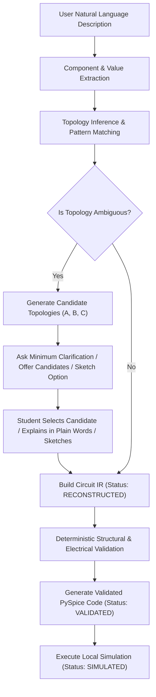

# Progressive Circuit Reconstruction & Generic Circuit Reasoning

## 1. Overview & Philosophy
Most students and electrical engineering learners do **not** think in SPICE netlist syntax or node connection matrices. When approaching an experiment or solving an assignment, a student often only knows:
- Voltage or current source ratings (e.g., $12\text{ V DC}$, $230\text{ V AC}$)
- Discrete component values (e.g., $R_1 = 2\text{ k}\Omega$, $C_1 = 10\ \mu\text{F}$)
- Informal relationships (e.g., "in series", "in parallel", "bridges the midpoint")
- High-level functional goals (e.g., "measure DC bias voltages", "step response", "rectification")

The KTU **23EEP20B Simulation Lab Manual** serves as an authoritative reference source, but **not as a restriction**. SIMLAB AI must reason over generic, custom, modified, or unseen circuits with equal precision.

---

## 2. Progressive Circuit Reconstruction Workflow



---

## 3. Clear Information Boundaries
Every response in progressive circuit reasoning strictly demarcates:

| Information Category | Definition & Scope | Example |
| :--- | :--- | :--- |
| **USER-PROVIDED VALUES** | Values and components explicitly extracted from the student's prompt. | `V1 = 12V`, `R1 = 2kΩ`, `R2 = 1kΩ` |
| **MANUAL-DERIVED INFORMATION** | Citations from `23EEP20B` manual if applicable; otherwise explicitly marked as generic. | `Experiment 1 · Pages 3–4` or `Generic custom circuit` |
| **AI-INFERRED TOPOLOGY** | Hypothesized topologies synthesized with rationales and confidence metrics. | `Candidate A: Wheatstone (70%)`, `Candidate B: Ladder (45%)` |
| **USER-CONFIRMED TOPOLOGY** | The specific topology selected or clarified by the user. | User: "Use Candidate A" |
| **SIMULATOR-VALIDATED TOPOLOGY** | Deterministically verified topology free of floating nodes or short circuits. | `VALIDATED` |
| **SIMULATION RESULTS** | Measured node voltages, branch currents, or transient waveforms. | `Node 2: 6.0000 V`, `Node 3: 4.0000 V` |

---

## 4. Lifecycle States in Circuit IR
Circuit IR metadata strictly maintains lifecycle tracking:
- `INFERRED`: Topology synthesized from partial descriptions; candidate choices available.
- `RECONSTRUCTED`: Selected candidate or unambiguous connectivity assembled into a netlist.
- `VALIDATED`: Deterministic graph checks passed (at least one GND, no isolated components, continuous loops).
- `SIMULATED`: Executed via local PySpice / Ngspice with numerical solutions.

```json
{
  "version": "1.0",
  "metadata": {
    "name": "Five-Resistor Bridge Network (Candidate A)",
    "experiment": 1,
    "topology_source": "ai_inferred",
    "confidence": 0.85,
    "user_confirmed": true,
    "status": "VALIDATED"
  },
  "components": [
    {"id": "V1", "type": "dc_voltage_source", "value": 12.0, "unit": "V", "nodes": ["1", "GND"]},
    {"id": "R1", "type": "resistor", "value": 2000.0, "unit": "ohm", "nodes": ["1", "2"]},
    {"id": "R2", "type": "resistor", "value": 1000.0, "unit": "ohm", "nodes": ["1", "3"]},
    {"id": "R3", "type": "resistor", "value": 2000.0, "unit": "ohm", "nodes": ["2", "GND"]},
    {"id": "R4", "type": "resistor", "value": 2000.0, "unit": "ohm", "nodes": ["3", "GND"]},
    {"id": "R5", "type": "resistor", "value": 1000.0, "unit": "ohm", "nodes": ["2", "3"]}
  ],
  "nodes": ["1", "2", "3", "GND"],
  "ground_node": "GND",
  "analysis": {
    "type": "op"
  }
}
```

---

## 5. Non-Demanding Clarification Workflow
When a circuit is ambiguous, SIMLAB AI **never** asks students:
> ❌ *"Please provide node numbers and SPICE netlist syntax for your resistors."*

Instead, SIMLAB AI presents structured options:
> ✔️ **Option 1**: Click or reply `"Use Candidate A"` (or B, C).
> ✔️ **Option 2**: Describe the connection in everyday words (e.g., *"R1 is in series with R2, and R3 connects across R2"*).
> ✔️ **Option 3**: Switch to the **Sketch → Code** tab and draw a rough hand-drawn diagram on the whiteboard.
